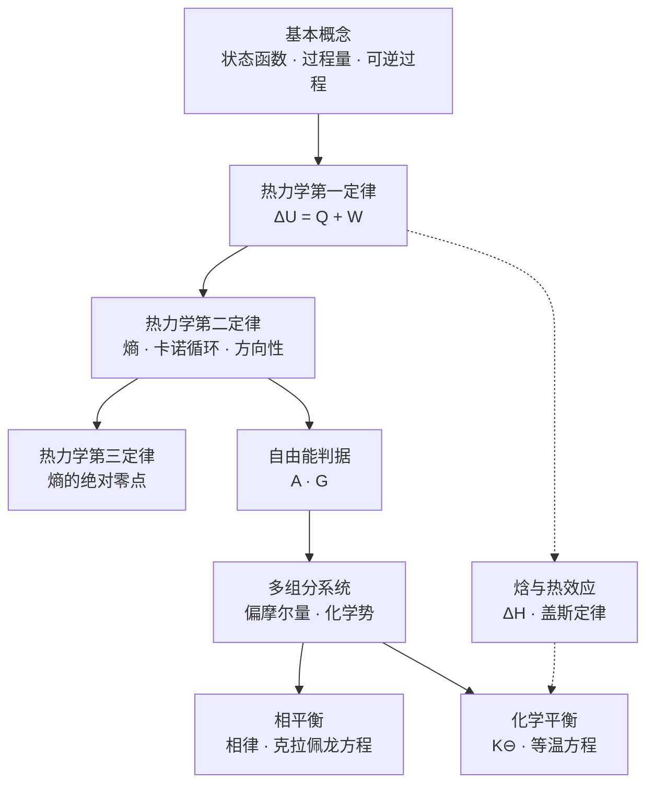
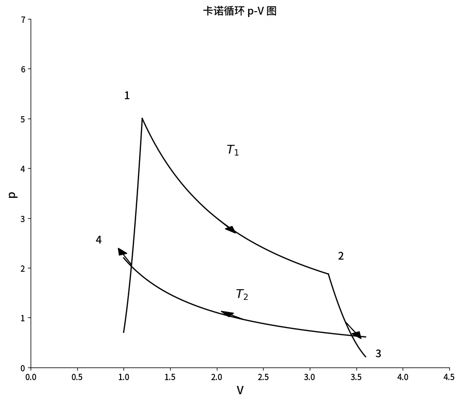

# 热力学笔记：物理量、关系与判据

  
  
  
  

> 从热力学第一定律到相平衡、化学平衡，把每个物理量的**定义、单位、符号规定、判据与易错点**串成一条线。
> 以课堂笔记为骨架，补全了原稿留白的章节，可作为物理化学 / 工程热力学的复习提纲与公式速查。

**这份笔记想解决三个问题：**

- 🧭 **量是什么**：每个物理量给出定义式、单位、广度/强度属性；
- ⚖️ **判据怎么用**：自发、平衡、可逆分别对应哪个不等式，适用条件是什么；
- 🧮 **题怎么算**：理想气体各过程、熵变、$\Delta G$、相变与平衡常数，配公式速查表。

---

## 目录

- [0. 阅读指南](#0-阅读指南)
- [1. 基本概念与约定](#1-基本概念与约定)
- [2. 热力学第一定律](#2-热力学第一定律)
- [3. 热力学第二定律](#3-热力学第二定律)
- [4. 多组分系统与溶液热力学](#4-多组分系统与溶液热力学)
- [5. 相平衡（补充）](#5-相平衡补充)
- [6. 化学平衡（补充）](#6-化学平衡补充)
- [7. 公式速查表](#7-公式速查表)
- [8. 易错点清单](#8-易错点清单)
- [9. 修订说明](#9-修订说明)
- [10. 参考资料](#10-参考资料)
- [11. 许可与贡献](#11-许可与贡献)

> 标注**（补充）** 的章节是在原始笔记基础上补全的内容；其余均整理自原始笔记。

---

## 0. 阅读指南

### 知识地图

### 三条主线

| 主线 | 回答的问题 | 核心工具 |
| --- | --- | --- |
| 能量守恒 | 过程前后能量如何记账 | $\Delta U=Q+W$、$\Delta H=Q_p$ |
| 过程方向 | 过程能否自发、何时平衡 | $\Delta S_{\text{绝热}}\ge0$、$\Delta A_{T,V}\le0$、$\Delta G_{T,p}\le0$ |
| 组成变化 | 物质如何在相间、组分间转移 | 化学势 $\mu_i$、平衡常数 $K^{\ominus}$ |

### 建议阅读顺序

1. 先读 **§1**，把状态函数 / 过程量、可逆过程搞清楚——后面所有判据都建立在这两个概念上；
2. **§2** 只记四条：$\Delta U=Q+W$、$H=U+pV$、$Q_V=\Delta U$、$Q_p=\Delta H$；
3. **§3** 是重点，抓住"熵 → 克劳修斯不等式 → 三个判据"这条推导链；
4. **§4** 之后进入溶液与平衡，核心只有一句：**一切自发变化都朝着化学势降低的方向进行**。

---

## 1. 基本概念与约定

### 1.1 系统与环境

| 系统类型 | 物质交换 | 能量交换 | 典型例子 |
| --- | --- | --- | --- |
| 敞开系统 | ✅ | ✅ | 开口烧杯 |
| 封闭系统 | ❌ | ✅ | 密封钢瓶 |
| 隔离（孤立）系统 | ❌ | ❌ | 理想杜瓦瓶 |

热力学第一、二定律的判据，绝大多数默认**封闭系统**。

### 1.2 状态函数与过程量

| 类别 | 特征 | 例子 |
| --- | --- | --- |
| **状态函数**（状态量） | 只与当前状态有关，与路径无关；微小变化是全微分 $\mathrm{d}Y$；环路积分为 0 | $U$、$H$、$S$、$A$、$G$、$T$、$p$、$V$ |
| **过程量** | 与具体路径有关；微小量用 $\delta$ 表示，不是全微分 | $W$、$Q$ |

$$
\oint \mathrm{d}U = 0
\qquad\text{但}\qquad
W \ne \Delta(\text{某状态函数})
$$

> ⚠️ 常见错误：写 $\Delta W$、$\Delta Q$。功和热没有"状态"，只有过程量，应写 $W$、$Q$ 或 $\delta W$、$\delta Q$。

状态函数的增量可用任意一条方便的可逆路径计算——这正是熵、$\Delta G$ 能算出来的原因。

### 1.3 广度性质与强度性质

- **广度（容量）性质**：与物质的量成正比，如 $V$、$U$、$H$、$S$、$G$，可加和；
- **强度性质**：与物质的量无关，如 $T$、$p$、$\mu_i$、摩尔量 $X_m$、密度。

摩尔量 $X_m = X/n$ 是强度性质；偏摩尔量 $X_i$ 也是强度性质。

### 1.4 可逆过程

**定义**：过程进行得无限缓慢，系统与环境始终无限接近平衡，系统沿原路返回时环境也能复原、不留痕迹。

三个关键词：**无限缓慢**、**步步平衡**、**双向可逆**。

用途：可逆过程做的功最大（膨胀时系统对外做功最多，压缩时环境耗功最少），因此熵、$\Delta G$ 的定义都取可逆路径。

### 1.5 标准态

- 标准压力 $p^{\ominus}=100\ \text{kPa}$（1982 年 IUPAC 起；旧教材为 $101.325\ \text{kPa}$，注意单位制）；
- 标准态只规定压力，**不规定温度**，但通常取 298.15 K 列表；
- 上标 $\ominus$ 表示标准态，如 $\Delta_f H_m^{\ominus}$、$S_m^{\ominus}$、$K^{\ominus}$。

> 标准态是"假想态"：气体按理想气体处理，溶液按无限稀释时仍服从亨利定律的外推态处理。

---

## 2. 热力学第一定律

### 2.1 功 $W$（J）

**符号规定**：系统对环境做功 $W<0$；环境对系统做功 $W>0$。

**体积功**（膨胀功）：

$$
\delta W=-p_{\text{amb}}\,\mathrm{d}V
\qquad\Longrightarrow\qquad
W=-\int_{V_1}^{V_2}p_{\text{amb}}\,\mathrm{d}V
$$

| 情形 | 功的表达式 |
| --- | --- |
| 恒外压 | $W=-p_{\text{amb}}(V_2-V_1)$ |
| 可逆（$p_{\text{amb}}=p$） | $W=-\displaystyle\int_{V_1}^{V_2}p\,\mathrm{d}V$ |
| 理想气体恒温可逆 | $W=-nRT\ln\dfrac{V_2}{V_1}=nRT\ln\dfrac{p_2}{p_1}$ |
| 恒容 | $W=0$ |
| 自由膨胀（真空） | $W=0$ |

**非体积功** $w'$：电功、表面功、机械功等。热化学中通常令 $w'=0$，此时

$$
\Delta U=Q+W=Q-\int p\,\mathrm{d}V
$$

### 2.2 热 $Q$（J）

系统与环境因**温度差**而交换的能量。

**符号规定**：系统吸热 $Q>0$；系统放热 $Q<0$。

热是过程量，与路径有关：同样的始末态，走不同路径交换的热量不同。

### 2.3 热力学能（内能）$U$（J）

系统内部所有粒子能量的总和：

- 分子的平动、转动、振动能量；
- 电子与核的运动能量；
- 分子间相互作用势能。

**不包含**：系统整体运动的动能、系统在外场中的势能。

$U$ 是状态函数，但**绝对值不可知**，只能求 $\Delta U$。

### 2.4 热力学第一定律

$$
\boxed{\mathrm{d}U=\delta Q+\delta W}
\qquad
\boxed{\Delta U=Q+W}
$$

**文字表述**：外界传给系统的热量 $Q$，加上外界对系统做的功 $W$，等于系统热力学能的增量 $\Delta U$。能量不会凭空产生或消灭，只能相互转化。

对隔离系统：$Q=0,\ W=0 \Rightarrow \Delta U=0$。

### 2.5 焦耳实验：理想气体的 $U$ 只是温度的函数

理想气体向真空膨胀，达到新平衡后温度不变：

$$
W=0\ (\text{真空，}p_{\text{ext}}=0),\qquad
Q=0\ (\text{水温不变}),\qquad
\Delta U=0
$$

而

$$
\mathrm{d}U=\left(\frac{\partial U}{\partial T}\right)_{V}\mathrm{d}T
+\left(\frac{\partial U}{\partial V}\right)_{T}\mathrm{d}V
$$

代入 $\mathrm{d}T=0,\ \mathrm{d}U=0$ 且 $\mathrm{d}V\ne0$，得

$$
\left(\frac{\partial U}{\partial V}\right)_{T}=0
\;\Longrightarrow\;
U=U(T)
$$

同理对理想气体有 $H=H(T)$。这是**理想气体**的专有性质，真实气体不成立。

### 2.6 恒压热与焓

恒压、非体积功为零时 $p_{\text{amb}}=p=$ 常数：

$$
W=-p(V_2-V_1)=pV_1-pV_2
$$

$$
\Delta U=Q_p+W=Q_p+pV_1-pV_2
$$

整理得

$$
\boxed{Q_p=(U_2+pV_2)-(U_1+pV_1)=\Delta H}
$$

**焓的定义**：

$$
H\equiv U+pV
$$

焓是状态函数，绝对值同样不可知；它是为"恒压热"量身定做的组合量。

### 2.7 两个关键等式

$$
\boxed{Q_V=\Delta U}\qquad\qquad \boxed{Q_p=\Delta H}
$$

**意义**：把**不可直接测量的状态量变化**，转化为**可测量的过程量**。所以只需要规定一个基态，其他状态的相对值即可确定——实际关心的不是某个状态的绝对值，而是过程的变化量。

> 成立条件：封闭系统、非体积功为零。有电功等 $w'\ne0$ 时，$Q_p=\Delta H-w'$。

### 2.8 摩尔热容

| 名称 | 符号 | 定义（1 mol，$w'=0$，升温 1 K） | 单位 |
| --- | --- | --- | --- |
| 恒容摩尔热容 | $C_{V,m}$ | $C_{V,m}=\dfrac{1}{n}\left(\dfrac{\delta Q_V}{\mathrm{d}T}\right)$ | J·mol⁻¹·K⁻¹ |
| 恒压摩尔热容 | $C_{p,m}$ | $C_{p,m}=\dfrac{1}{n}\left(\dfrac{\delta Q_p}{\mathrm{d}T}\right)$ | J·mol⁻¹·K⁻¹ |

$$
Q_V=\Delta U=n\int_{T_1}^{T_2}C_{V,m}\,\mathrm{d}T
\qquad
Q_p=\Delta H=n\int_{T_1}^{T_2}C_{p,m}\,\mathrm{d}T
$$

**理想气体的关系**：

$$
\boxed{C_{p,m}-C_{V,m}=R}
\qquad
\gamma=\frac{C_{p,m}}{C_{V,m}},\quad
C_{V,m}=\frac{R}{\gamma-1}
$$

单原子理想气体：$C_{V,m}=\tfrac{3}{2}R$；双原子：$C_{V,m}=\tfrac{5}{2}R$。

### 2.9 理想气体典型过程一览

| 过程 | 约束 | $W$ | $Q$ | $\Delta U$ | $\Delta H$ |
| --- | --- | --- | --- | --- | --- |
| 恒温可逆 | $T$ 恒定 | $-nRT\ln\dfrac{V_2}{V_1}$ | $nRT\ln\dfrac{V_2}{V_1}$ | $0$ | $0$ |
| 绝热可逆 | $Q=0$ | $nC_{V,m}(T_2-T_1)$ | $0$ | $nC_{V,m}\Delta T$ | $nC_{p,m}\Delta T$ |
| 恒容 | $\mathrm{d}V=0$ | $0$ | $nC_{V,m}\Delta T$ | $nC_{V,m}\Delta T$ | $nC_{p,m}\Delta T$ |
| 恒压 | $p$ 恒定 | $-p\Delta V=-nR\Delta T$ | $nC_{p,m}\Delta T$ | $nC_{V,m}\Delta T$ | $nC_{p,m}\Delta T$ |

**绝热可逆过程方程**（理想气体）：

$$
pV^{\gamma}=\text{const},\qquad
TV^{\gamma-1}=\text{const},\qquad
T^{\gamma}p^{1-\gamma}=\text{const}
$$

> 注意：**绝热**不等于**恒温**。绝热膨胀温度下降，绝热压缩温度升高。

### 2.10 化学反应焓

对反应 $aA+bB\rightleftharpoons dD+eE$：

1. 焓是状态函数，只需始末态即可求 $\Delta_r H$；恒压反应热即为 $\Delta_r H$；
2. 逐个实测不现实，于是建立热力学数据库：**标准摩尔生成焓** $\Delta_f H_m^{\ominus}$——在温度 $T$ 的标准态下，由**稳定相态单质**生成 1 mol 该化合物过程的焓变；
3. 由盖斯定律（状态函数性质）求反应焓：

$$
\boxed{\Delta_r H_m^{\ominus}=\sum_{B}\nu_B\,\Delta_f H_m^{\ominus}(B)}
$$

其中 $\nu_B$ 为化学计量数（**生成物取正、反应物取负**）。稳定单质的 $\Delta_f H_m^{\ominus}=0$。

**反应焓随温度变化（基尔霍夫定律）**：

$$
\Delta_r H_m^{\ominus}(T_2)=\Delta_r H_m^{\ominus}(T_1)+\int_{T_1}^{T_2}\Delta_r C_{p,m}\,\mathrm{d}T,
\qquad
\Delta_r C_{p,m}=\sum_B \nu_B C_{p,m}(B)
$$

**键焓估算**：$\Delta_r H_m^{\ominus}\approx\sum(\text{断裂的键能})-\sum(\text{形成的键能})$，仅用于气相、近似估算。

---

## 3. 热力学第二定律

### 3.1 为什么需要第二定律

第一定律只管"能量守恒"，管不了**方向**：热自发从高温传到低温，绝不会反过来；气体自发扩散，绝不会自发聚拢。第二定律就是回答"过程朝哪个方向走、走到哪里停"。

### 3.2 两种经典表述

- **克劳修斯说法**：热不能自动地从低温物体传给高温物体而不引起其他变化。
- **开尔文说法**：不可能从单一热源吸热，使之全部对外做功而不引起其他变化。

两者等价，共同指出自然过程具有方向性；"不引起其他变化"是关键限定——制冷机、热泵可以逆向传热，但要消耗功。

### 3.3 卡诺循环

理想气体可逆循环，由两个恒温过程和两个绝热过程组成：

*图：卡诺循环的 p–V 图（1→2 恒温膨胀，2→3 绝热膨胀，3→4 恒温压缩，4→1 绝热压缩）*

| 过程 | 类型 | 交换量 |
| --- | --- | --- |
| 1→2 | 恒温可逆膨胀（$T_1$） | $Q_1=-W_1=nRT_1\ln\dfrac{V_2}{V_1}>0$ |
| 2→3 | 绝热可逆膨胀 | $Q=0,\quad W_2=nC_{V,m}(T_2-T_1)$ |
| 3→4 | 恒温可逆压缩（$T_2$） | $Q_2=-W_3=nRT_2\ln\dfrac{V_4}{V_3}<0$ |
| 4→1 | 绝热可逆压缩 | $Q=0,\quad W_4=nC_{V,m}(T_1-T_2)$ |

由两段绝热过程：

$$
\frac{T_1}{T_2}=\left(\frac{V_4}{V_1}\right)^{R/C_{V,m}}
=\left(\frac{V_3}{V_2}\right)^{R/C_{V,m}}
\;\Longrightarrow\;
\frac{V_4}{V_3}=\frac{V_1}{V_2}
$$

净功与热机效率：

$$
-W=Q_1+Q_2=nR(T_1-T_2)\ln\frac{V_2}{V_1}
$$

$$
\boxed{\eta=\frac{-W}{Q_1}=\frac{Q_1+Q_2}{Q_1}=\frac{T_1-T_2}{T_1}=1-\frac{T_2}{T_1}}
$$

**结论**：卡诺热机效率只取决于两个热源温度，与工作物质无关——这是提高热机效率的理论上限。等价地，

$$
\frac{Q_1}{T_1}+\frac{Q_2}{T_2}=0
$$

### 3.4 熵

任意可逆循环中

$$
\oint\frac{\delta Q_r}{T}=0
$$

环路积分为零，说明 $\delta Q_r/T$ 是某个**状态函数**的全微分，定义为**熵**：

$$
\boxed{\mathrm{d}S=\frac{\delta Q_r}{T}}
\qquad
\Delta S=\int_{1}^{2}\frac{\delta Q_r}{T}
\quad(\text{J·K}^{-1})
$$

**推论**：

- 可逆绝热过程即**等熵过程**（$\Delta S=0$）；
- 不可逆过程的 $\Delta S$ 不能直接积分求，必须在相同始末态之间**设计一条可逆路径**再算——这正是熵变计算的标准套路。

**理想气体熵变**（任意过程）：

$$
\Delta S=nC_{V,m}\ln\frac{T_2}{T_1}+nR\ln\frac{V_2}{V_1}
=nC_{p,m}\ln\frac{T_2}{T_1}-nR\ln\frac{p_2}{p_1}
$$

### 3.5 熵变计算速查

| 过程 | $\Delta S$ |
| --- | --- |
| 恒温（理想气体） | $nR\ln\dfrac{V_2}{V_1}=-nR\ln\dfrac{p_2}{p_1}$ |
| 恒容 | $nC_{V,m}\ln\dfrac{T_2}{T_1}$ |
| 恒压 | $nC_{p,m}\ln\dfrac{T_2}{T_1}$ |
| 可逆相变（$T,p$ 恒定） | $\dfrac{\Delta H_{\text{相变}}}{T}$ |
| 绝热可逆 | $0$ |
| 绝热不可逆 | 由熵增原理判方向，需设计可逆路径计算 |

> 相变熵与温度有关，但**不可逆相变**（如过冷水的凝固）必须拆成"可逆加热（或冷却）+ 可逆相变 + 可逆冷却（或加热）"三步来算。

### 3.6 克劳修斯不等式与熵增原理

由卡诺定理 $\eta_i\le\eta_r$ 推广得

$$
\oint\frac{\delta Q}{T}\le0
\qquad\Longrightarrow\qquad
\boxed{\mathrm{d}S\ge\frac{\delta Q}{T}}
$$

- 可逆过程取等号；
- 不可逆过程取大于号；
- 该式是第二定律的**数学表达式**，一切判据都由它推出。

**熵增原理**：绝热（或隔离）系统由始态到末态——不可逆过程熵增大，可逆过程熵不变，**熵减小的绝热过程不可能发生**：

$$
\boxed{\Delta S_{\text{绝热}}\ge0}
$$

更一般的熵判据（隔离系统）：

$$
\Delta S_{\text{iso}}=\Delta S_{\text{sys}}+\Delta S_{\text{amb}}\ge0
$$

### 3.7 热力学第三定律

$$
S^{*}(0\,\text{K},\ \text{完美晶体})=0
$$

**意义**：熵有了绝对零点，因此某状态的熵值可以测得（$S=\int_0^T\frac{C_p}{T}\mathrm{d}T$ 加上相变熵）；而内能、焓的绝对值仍不可测，只能取相对值。

**推论**：0 K 附近完美晶体的 $C_p\to0$，任何真实过程无法达到 0 K（绝对零度不可达）。

### 3.8 亥姆霍兹函数与吉布斯函数

熵判据需要同时算系统和环境，不方便。恒温恒容 / 恒温恒压下可以把环境熵折进系统，得到只用系统自身性质的判据。

**亥姆霍兹函数**（恒温恒容）：

$$
A\equiv U-TS
\qquad
\boxed{\mathrm{d}A_{T,V}\le0,\quad \Delta A_{T,V}\le0}
$$

**吉布斯函数**（恒温恒压，最常用）：

$$
G\equiv H-TS
\qquad
\boxed{\mathrm{d}G_{T,p}\le0,\quad \Delta G_{T,p}\le0}
$$

**物理意义**：

$$
\Delta A_{T,V}=W_r'
\qquad
\Delta G_{T,p}=W_r'
$$

其中 $W_r'$ 为**可逆非体积功**。即：恒温恒容（恒压）下，系统对外做可逆非体积功的能力，等于 $A$（$G$）的减少量。

> 电化学电池就是典型：$\Delta_r G_m=-zFE$，把化学能转成电功。

**判据汇总**：

| 判据 | 条件 | 表达式 | 含义 |
| --- | --- | --- | --- |
| 熵判据 | 隔离（绝热）系统 | $\Delta S\ge0$ | 最根本，普适但需算环境 |
| 亥姆霍兹判据 | 恒温恒容、$w'=0$ | $\Delta A\le0$ | 系统自身即可判断 |
| 吉布斯判据 | 恒温恒压、$w'=0$ | $\Delta G\le0$ | 化学最常用 |

三种判据等价：$<0$ 自发，$=0$ 平衡，$>0$ 非自发（逆向自发）。

### 3.9 热力学基本方程

封闭系统、可逆、非体积功为零时，四个特性函数的基本微分方程：

| 特性函数 | 定义式 | 基本微分方程 | 适用条件 |
| --- | --- | --- | --- |
| 内能 $U$ | 基础状态函数 | $\mathrm{d}U=T\,\mathrm{d}S-p\,\mathrm{d}V$ | 封闭、可逆、$w'=0$ |
| 焓 $H$ | $H=U+pV$ | $\mathrm{d}H=T\,\mathrm{d}S+V\,\mathrm{d}p$ | 封闭、可逆、$w'=0$ |
| 亥姆霍兹函数 $A$ | $A=U-TS$ | $\mathrm{d}A=-S\,\mathrm{d}T-p\,\mathrm{d}V$ | 封闭、可逆、$w'=0$ |
| 吉布斯函数 $G$ | $G=H-TS$ | $\mathrm{d}G=-S\,\mathrm{d}T+V\,\mathrm{d}p$ | 封闭、可逆、$w'=0$ |

这四个方程是"记忆母版"：由它们可以直接读出

$$
T=\left(\frac{\partial U}{\partial S}\right)_{V},\quad
p=-\left(\frac{\partial U}{\partial V}\right)_{S},\quad
S=-\left(\frac{\partial G}{\partial T}\right)_{p},\quad
V=\left(\frac{\partial G}{\partial p}\right)_{T}
$$

**麦克斯韦关系**（由二阶偏导连续、交叉偏导相等得到）：

$$
\left(\frac{\partial T}{\partial V}\right)_{S}=-\left(\frac{\partial p}{\partial S}\right)_{V}
\qquad
\left(\frac{\partial T}{\partial p}\right)_{S}=\left(\frac{\partial V}{\partial S}\right)_{p}
$$

$$
\left(\frac{\partial S}{\partial V}\right)_{T}=\left(\frac{\partial p}{\partial T}\right)_{V}
\qquad
\left(\frac{\partial S}{\partial p}\right)_{T}=-\left(\frac{\partial V}{\partial T}\right)_{p}
$$

> 用途：把难测的熵偏导，换成可测的 $p$-$V$-$T$ 关系。

### 3.10 吉布斯-亥姆霍兹方程

$$
\left[\frac{\partial\,(G/T)}{\partial T}\right]_{p}
=\frac{1}{T}\left(\frac{\partial G}{\partial T}\right)_{p}-\frac{G}{T^{2}}
=-\frac{S}{T}-\frac{G}{T^{2}}
=-\frac{G+TS}{T^{2}}
=\boxed{-\frac{H}{T^{2}}}
$$

对反应同样成立：

$$
\left[\frac{\partial\,(\Delta G/T)}{\partial T}\right]_{p}=-\frac{\Delta H}{T^{2}}
$$

**用途**：由 $\Delta G$ 随温度的变化反推 $\Delta H$，或由 $\Delta H$ 求不同温度下的 $\Delta G$。

---

## 4. 多组分系统与溶液热力学

### 4.1 偏摩尔量

对 $N$ 种物质的体系，某容量性质 $Y$ 是 $T,p,n_i$ 的函数：

$$
Y=f(T,p,n_1,n_2,\cdots,n_i,\cdots)
$$

恒温恒压下，组元 $i$ 的偏摩尔量：

$$
\boxed{Y_i=\left(\frac{\partial Y}{\partial n_i}\right)_{T,p,n_{j\ne i}}}
$$

**物理意义**：恒温恒压、其他组分不变时，加入 1 mol 物质 $i$ 引起系统性质 $Y$ 的变化。

> 偏摩尔量是**强度性质**。纯物质的偏摩尔量就等于其摩尔量。

### 4.2 化学势

$$
\boxed{\mu_i=G_i=\left(\frac{\partial G}{\partial n_i}\right)_{T,p,n_{j\ne i}}}
$$

**物理意义**：恒温恒压下，向系统加入 1 mol 物质 $i$（其他组分不变）时，系统吉布斯自由能的增量。化学势是判断物质转移方向的"势"，相当于多组分系统的"电压"。

**与组成的关系**（理想气体）：

$$
\mu_i=\mu_i^{\ominus}(T)+RT\ln\frac{p_i}{p^{\ominus}}
$$

### 4.3 集合公式

恒温恒压：

$$
\mathrm{d}Y=\sum_i Y_i\,\mathrm{d}n_i
\qquad
Y=\sum_i n_i Y_i
\qquad
Y_m=\sum_i x_i Y_i
$$

> 注意：只有**恒温恒压**下才写成 $Y=\sum n_iY_i$；否则还要加上 $\left(\frac{\partial Y}{\partial T}\right)_{p,n}\mathrm{d}T$ 等项。

### 4.4 吉布斯-杜亥姆方程

恒温恒压：

$$
\boxed{\sum_i n_i\,\mathrm{d}Y_i=0}
$$

**含义**：各偏摩尔量之间不独立，一个变，其他必随之变——这正是"拉乌尔定律与亨利定律互相制约"的根源。

### 4.5 化学势判据

非体积功为零时，对任意相 $\alpha$、组分 $B$：

$$
\boxed{\sum_{\alpha}\sum_{B}\mu_B(\alpha)\,\mathrm{d}n_B(\alpha)\le0}
$$

| 判据值 | 含义 |
| --- | --- |
| $<0$ | 过程自发进行 |
| $=0$ | 系统达到平衡 |
| $>0$ | 过程不能自发进行 |

恒温恒压（吉布斯判据）与恒温恒容（亥姆霍兹判据）的数学形式完全一致，差别只在 $\mathrm{d}n_B$ 所受的约束。

**应用一：两相 $\alpha,\beta$ 相变**

由 $\mathrm{d}n_B(\alpha)=-\mathrm{d}n_B(\beta)$ 代入化简：

$$
\left[\mu_B(\alpha)-\mu_B(\beta)\right]\mathrm{d}n_B(\beta)\le0
$$

- 自发相变：$\mu_B(\alpha)>\mu_B(\beta)$——物质从**化学势高**的相转移到**化学势低**的相；
- 相平衡：$\mu_B(\alpha)=\mu_B(\beta)$。

**应用二：多组分系统化学平衡**

平衡时同一组分在各共存相中化学势相等，可省略相标号记为 $\mu_B$；令 $\mathrm{d}n_B=\sum_\alpha\mathrm{d}n_B(\alpha)$，化学平衡条件为

$$
\boxed{\sum_B\mu_B\,\mathrm{d}n_B=0}
$$

结合 $\mu_B=\mu_B^{\ominus}+RT\ln a_B$，即得平衡常数表达式（见 [§6](#6-化学平衡补充)）。

### 4.6 拉乌尔定律与亨利定律

**拉乌尔定律**：一定温度下，稀溶液中溶剂的蒸气压等于纯溶剂的饱和蒸气压乘以溶剂的摩尔分数。

$$
\boxed{p_A=p_A^{\star}\,x_A}
$$

**亨利定律**：稀溶液中挥发性溶质的分压与其摩尔分数成正比。

$$
p_B=k_{x,B}\,x_B
$$

- $k_{x,B}$ 为亨利常数，与温度、溶质、溶剂有关；
- 拉乌尔定律管**溶剂**，亨利定律管**溶质**，两者共同描述稀溶液；
- 理想溶液：全部浓度范围内都服从拉乌尔定律的溶液。

### 4.7 理想溶液的化学势

$$
\boxed{\mu_i=\mu_i^{\star}(T,p)+RT\ln x_i}
$$

其中 $\mu_i^{\star}$ 为同温同压下纯 $i$ 的化学势。由此可得混合性质：

$$
\Delta_{\text{mix}}G=nRT\sum_i x_i\ln x_i<0
\qquad
\Delta_{\text{mix}}S=-nR\sum_i x_i\ln x_i>0
$$

$$
\Delta_{\text{mix}}H=0
\qquad
\Delta_{\text{mix}}V=0
$$

**结论**：理想溶液的混合是**自发**的（$\Delta G<0$），且只由熵驱动——这正是"理想"二字的含义。

### 4.8 稀溶液的依数性

稀溶液中，溶质的粒子数决定性质，与溶质本性无关：

| 性质 | 公式 | 说明 |
| --- | --- | --- |
| 蒸气压下降 | $\Delta p=p_A^{\star}x_B$ | 拉乌尔定律的直接结果 |
| 沸点升高 | $\Delta T_b=K_b\,b_B$ | $K_b$ 为沸点升高常数 |
| 凝固点降低 | $\Delta T_f=K_f\,b_B$ | $K_f$ 为凝固点降低常数，$b_B$ 为质量摩尔浓度 |
| 渗透压 | $\Pi=c_B RT$ | 与理想气体状态方程同形 |

**用途**：测摩尔质量、判断溶质是否解离（电解质需乘 van't Hoff 因子 $i$）。

### 4.9 活度与逸度

真实系统偏离理想行为，用**活度** $a$ 替代浓度、用**逸度** $f$ 替代压力：

$$
\mu_i=\mu_i^{\ominus}+RT\ln a_i,
\qquad
a_i=\gamma_i\,x_i
$$

$$
\mu=\mu^{\ominus}+RT\ln\frac{f}{p^{\ominus}}
$$

- $\gamma_i$ 为活度因子：$\gamma_i=1$ 即理想；$\gamma_i<1$ 表示对拉乌尔定律负偏差；
- 稀溶液中溶质常取 $a_B=b_B/b^{\ominus}$；
- 标准态不同，活度的定义式不同，计算时必须配套使用。

---

## 5. 相平衡（补充）

### 5.1 相律

$$
\boxed{f=C-P+2}
$$

- $f$：自由度（可独立改变而不改变相数的强度变量个数）；
- $C$：独立组分数；
- $P$：相数；
- $2$：温度与压力两个变量（若压力固定，则为 $f=C-P+1$）。

**单组分系统**：$C=1$，$f=3-P$。三相点 $P=3\Rightarrow f=0$，温度压力都被锁定。

### 5.2 克拉佩龙方程

任意两相平衡时：

$$
\boxed{\frac{\mathrm{d}p}{\mathrm{d}T}=\frac{\Delta H_m}{T\,\Delta V_m}}
$$

用于 $p$–$T$ 相图曲线的斜率；$\Delta V_m>0$（如蒸发）时斜率为正，$\Delta V_m<0$（如冰熔化）时斜率为负。

### 5.3 克劳修斯-克拉佩龙方程

气-液（或气-固）平衡，假设蒸气为理想气体且 $V_m(\text{g})\gg V_m(\text{l/s})$：

$$
\frac{\mathrm{d}\ln p}{\mathrm{d}T}=\frac{\Delta H_{\text{vap}}}{RT^{2}}
$$

积分形式（$\Delta H_{\text{vap}}$ 视为常数）：

$$
\boxed{\ln\frac{p_2}{p_1}=-\frac{\Delta H_{\text{vap}}}{R}\left(\frac{1}{T_2}-\frac{1}{T_1}\right)}
$$

**用途**：由两组 $(T,p)$ 求汽化焓，或由汽化焓算不同温度下的饱和蒸气压。

### 5.4 单组分相图要点

- 三条平衡线（升华、熔化、汽化）交于**三相点**；
- 临界点以上无气液之分；
- 水的熔化曲线斜率为负（冰的密度小于水），这是"冰浮在水上"的热力学解释。

---

## 6. 化学平衡（补充）

### 6.1 标准平衡常数

$$
\boxed{\Delta_r G_m^{\ominus}=-RT\ln K^{\ominus}}
\qquad\Longleftrightarrow\qquad
K^{\ominus}=\exp\left(-\frac{\Delta_r G_m^{\ominus}}{RT}\right)
$$

对于气相反应 $aA+bB\rightleftharpoons dD+eE$：

$$
K^{\ominus}=\frac{(p_D/p^{\ominus})^{d}(p_E/p^{\ominus})^{e}}{(p_A/p^{\ominus})^{a}(p_B/p^{\ominus})^{b}}
$$

$K^{\ominus}$ 无量纲，只是温度的函数。

### 6.2 化学反应等温方程

$$
\Delta_r G_m=\Delta_r G_m^{\ominus}+RT\ln Q
=\boxed{RT\ln\frac{Q}{K^{\ominus}}}
$$

| 比较 | 结论 |
| --- | --- |
| $Q<K^{\ominus}$ | $\Delta_r G_m<0$，反应正向自发 |
| $Q=K^{\ominus}$ | $\Delta_r G_m=0$，平衡 |
| $Q>K^{\ominus}$ | $\Delta_r G_m>0$，反应逆向自发 |

### 6.3 温度对平衡的影响（van't Hoff 方程）

$$
\boxed{\frac{\mathrm{d}\ln K^{\ominus}}{\mathrm{d}T}=\frac{\Delta_r H_m^{\ominus}}{RT^{2}}}
$$

- 吸热反应（$\Delta H>0$）：升温，$K^{\ominus}$ 增大，平衡右移；
- 放热反应（$\Delta H<0$）：升温，$K^{\ominus}$ 减小，平衡左移。

积分形式（$\Delta H$ 为常数）：

$$
\ln\frac{K_2^{\ominus}}{K_1^{\ominus}}=\frac{\Delta_r H_m^{\ominus}}{R}\left(\frac{1}{T_1}-\frac{1}{T_2}\right)
$$

### 6.4 平衡移动的定性判断

勒夏特列原理：改变影响平衡的一个条件，平衡向**削弱**这种改变的方向移动。

- 增压 → 向气体分子数减少的方向移动；
- 升温 → 向吸热方向移动；
- 增加反应物浓度 → 正向移动（但 $K^{\ominus}$ 不变）。

> 催化剂只改变达到平衡的速率，**不改变** $K^{\ominus}$ 与平衡转化率。

---

## 7. 公式速查表

| 类别 | 公式 | 条件 |
| --- | --- | --- |
| 体积功 | $W=-\displaystyle\int p_{\text{amb}}\mathrm{d}V$ | 任意 |
| 第一定律 | $\Delta U=Q+W$ | 封闭系统 |
| 焓 | $H=U+pV$ | 定义 |
| 恒容热 | $Q_V=\Delta U$ | 恒容、$w'=0$ |
| 恒压热 | $Q_p=\Delta H$ | 恒压、$w'=0$ |
| 热容关系 | $C_{p,m}-C_{V,m}=R$ | 理想气体 |
| 卡诺效率 | $\eta=1-\dfrac{T_2}{T_1}$ | 可逆卡诺循环 |
| 熵变（定义） | $\mathrm{d}S=\dfrac{\delta Q_r}{T}$ | 可逆过程 |
| 熵增原理 | $\Delta S_{\text{绝热}}\ge0$ | 绝热 / 隔离 |
| 第三定律 | $S^{*}(0\,\text{K})=0$ | 完美晶体 |
| 亥姆霍兹判据 | $\Delta A_{T,V}\le0$ | 恒温恒容、$w'=0$ |
| 吉布斯判据 | $\Delta G_{T,p}\le0$ | 恒温恒压、$w'=0$ |
| 基本方程 | $\mathrm{d}G=-S\mathrm{d}T+V\mathrm{d}p$ | 封闭、可逆 |
| G-H 方程 | $\left[\partial(G/T)/\partial T\right]_p=-H/T^2$ | 恒压 |
| 反应吉布斯能 | $\Delta_r G_m^{\ominus}=\Delta_r H_m^{\ominus}-T\Delta_r S_m^{\ominus}$ | 标准态 |
| 化学势 | $\mu_i=\left(\dfrac{\partial G}{\partial n_i}\right)_{T,p,n_{j\ne i}}$ | 定义 |
| 化学势判据 | $\sum_\alpha\sum_B\mu_B(\alpha)\mathrm{d}n_B(\alpha)\le0$ | $w'=0$ |
| 拉乌尔定律 | $p_A=p_A^{\star}x_A$ | 理想 / 稀溶液溶剂 |
| 理想溶液化学势 | $\mu_i=\mu_i^{\star}+RT\ln x_i$ | 理想溶液 |
| 相律 | $f=C-P+2$ | 相平衡 |
| 克拉佩龙 | $\dfrac{\mathrm{d}p}{\mathrm{d}T}=\dfrac{\Delta H_m}{T\Delta V_m}$ | 两相平衡 |
| 平衡常数 | $\Delta_r G_m^{\ominus}=-RT\ln K^{\ominus}$ | 标准态 |
| 等温方程 | $\Delta_r G_m=RT\ln(Q/K^{\ominus})$ | 任意组成 |

**常用常数**：$R=8.314\ \text{J·mol}^{-1}\text{·K}^{-1}$；$p^{\ominus}=100\ \text{kPa}$；$0\ \text{K}=-273.15\ ^\circ\text{C}$。

---

## 8. 易错点清单

1. **符号**：$W$ 是"环境对系统做功为正"，与物理学的"系统对外做功为正"相反；$Q$ 吸热为正。做题先确认符号约定，否则整题结果差一个负号。
2. **$\Delta W$、$\Delta Q$**：功和热是过程量，没有全微分，不能写 $\Delta$。
3. **$Q_p=\Delta H$ 的条件**：恒压 **且** 非体积功为零。有电功时不成立。
4. **"绝热 = 恒温"**：错。绝热可逆膨胀温度必然下降。
5. **不可逆过程的 $\Delta S$**：不能直接对实际过程积分，要设计同始末态的可逆路径。
6. **$\Delta G<0$ 只判方向**：它表示恒温恒压下过程自发，不代表"反应快"；速率由动力学决定。
7. **$K^{\ominus}$ 只随温度变**：改变压力、浓度只改变 $Q$，不改变 $K^{\ominus}$。
8. **$r$ 与浓度**：热力学里 $a$（活度）替代浓度，稀溶液才可近似为 $c/c^{\ominus}$。
9. **偏摩尔量只在恒温恒压下定义**，且是强度性质，不能加和成总量（应乘 $n_i$ 再求和）。
10. **标准态 ≠ 标准状况**：标准态只规定压力 $100\ \text{kPa}$；标准状况是 $273.15\ \text{K}$、$101.325\ \text{kPa}$，两者无关。

---

## 9. 修订说明

本笔记以 `热力学中的物理量及其关系.docx` 为底稿整理，修正了原稿中的以下问题：

| # | 问题 | 处理 |
| --- | --- | --- |
| 1 | "恒压摩尔热容"及后续两式误写为 $C_{V,m}$ | 统一更正为 $C_{p,m}$ |
| 2 | 摩尔热容定义后的 $Q_V$、$Q_p$ 表达式用 $\sum$ 表示积分 | 更正为 $\int_{T_1}^{T_2}$ |
| 3 | "热力学基本方程""化学势判据"在原文中是截图 | 已转写为表格与公式，卡诺 p–V 图作为配图保留 |
| 4 | 末节"理想溶液中 i 组元的化学势"仅有标题 | 补全 §4.7，并延伸 §4.8 依数性、§4.9 活度与逸度 |
| 5 | 第二章标题缺"第二节"编号 | 本文改用 § 分节，不再依赖原编号 |
| 6 | 原文止于多组分系统 | 新增 §5 相平衡、§6 化学平衡，补齐知识闭环 |

---

## 10. 参考资料

- 王竹溪，《热力学》（第二版），北京大学出版社
- 傅献彩、沈文霞、姚天扬，《物理化学》（第五版），高等教育出版社
- 天津大学物理化学教研室，《物理化学》（第六版），高等教育出版社
- Atkins P., *Physical Chemistry*, 11th ed., Oxford University Press
- IUPAC, *Quantities, Units and Symbols in Physical Chemistry*（Green Book）
- CODATA 2018 推荐基本物理常量

---

## 11. 许可与贡献

- 内容采用 [CC BY 4.0](https://creativecommons.org/licenses/by/4.0/deed.zh-hans) 许可：可自由转载、修改，请注明出处。
- 发现公式错误、表述不清或想补充章节，欢迎提 Issue / PR；提交前请确认公式用 LaTeX 书写、每个判据注明适用条件。
- 若这份笔记对你有帮助，点个 ⭐ 就是最好的支持。

---

Made with ❤️ for thermodynamics · 最后更新：2026-06
